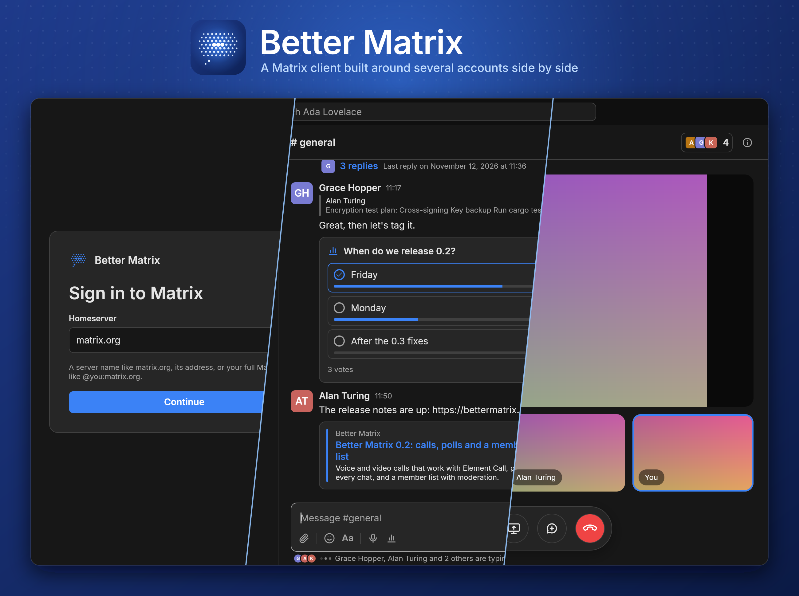

<div align="center">


# Better Matrix

**A Matrix client for Linux, macOS and Windows, built around several accounts side by side.**

[](https://github.com/m43i/better-matrix/actions/workflows/ci.yml)
[](https://github.com/m43i/better-matrix/releases/latest)
[](LICENSE)



</div>

## What it does

- **Every account at once.** Sign in to as many homeservers as you like and switch with one click;
  notifications, unread counts and calls work for all of them.
- **Encrypted by default.** Cross-signing, key backup and device verification, with the keys kept in
  your system's keychain.
- **Calls.** Voice and video calls, screen sharing and group calls, built to work with Element Call.
- **A tidy sidebar.** Spaces on a rail, your own sections, drag and drop, latest conversations first.
- **Everything a chat needs.** Threads, replies, reactions, polls, voice messages, files, GIFs and
  link previews.
- **Fast and native.** Rust from the network to the pixels, rendered on the GPU with
  [Rune](https://github.com/anomalyco/rune), in one process with a small memory footprint that sits
  idle when you do. In English, German and French.

## Install

Everything comes from the latest release on
[Releases](https://github.com/m43i/better-matrix/releases/latest). On macOS and Windows, download
the disk image or the installer below. On Linux, copy the line for your system into a terminal, or
download the files by hand. Linux packages come for x86_64 and ARM (aarch64); the commands pick the right one.
They need glibc 2.35 or newer: Ubuntu 22.04, Debian 12, Fedora 36, openSUSE Tumbleweed or later
(RHEL, AlmaLinux and Rocky Linux from version 10).

### Linux

**Debian, Ubuntu, Linux Mint, Pop!\_OS**

```sh
curl -fLo /tmp/better-matrix.deb "https://github.com/m43i/better-matrix/releases/latest/download/better-matrix-linux-$(uname -m).deb" && sudo apt install -y /tmp/better-matrix.deb
```

**Fedora, RHEL 10, AlmaLinux 10, Rocky Linux 10**

```sh
sudo dnf install -y "https://github.com/m43i/better-matrix/releases/latest/download/better-matrix-linux-$(uname -m).rpm"
```

**openSUSE**

```sh
sudo zypper install -y --allow-unsigned-rpm "https://github.com/m43i/better-matrix/releases/latest/download/better-matrix-linux-$(uname -m).rpm"
```

**Arch Linux, Manjaro, EndeavourOS**

```sh
curl -fLo /tmp/better-matrix.pkg.tar.xz "https://github.com/m43i/better-matrix/releases/latest/download/better-matrix-linux-$(uname -m).pkg.tar.xz" && sudo pacman -U --noconfirm /tmp/better-matrix.pkg.tar.xz
```

Or build the package yourself from the release's `PKGBUILD`:

```sh
mkdir -p ~/.cache/better-matrix && cd ~/.cache/better-matrix && curl -fLO https://github.com/m43i/better-matrix/releases/latest/download/PKGBUILD && makepkg -si
```

**Any other distribution: AppImage**

```sh
mkdir -p ~/.local/bin && curl -fLo ~/.local/bin/better-matrix "https://github.com/m43i/better-matrix/releases/latest/download/better-matrix-linux-$(uname -m).AppImage" && chmod +x ~/.local/bin/better-matrix && ~/.local/bin/better-matrix
```

AppImages need FUSE 2 (`libfuse2`, called `fuse2` or `fuse-libs` on some distributions). Without it,
start it with `--appimage-extract-and-run`.

### macOS (Apple silicon)

Download
[`better-matrix-macos-arm64.dmg`](https://github.com/m43i/better-matrix/releases/latest/download/better-matrix-macos-arm64.dmg),
open it and drag Better Matrix to Applications. The app isn't signed with an Apple Developer ID or
notarized yet, so macOS blocks it the first time you open it. Then open **System Settings → Privacy
& Security**, scroll down to the message about Better Matrix, choose **Open Anyway** and confirm
with **Open**. You only do this once;
updates from inside the app open straight away. Because of the missing signature, macOS asks
again for keychain, camera and microphone access after each update.

### Windows (x64)

Download and run
[`better-matrix-windows-x86_64-setup.exe`](https://github.com/m43i/better-matrix/releases/latest/download/better-matrix-windows-x86_64-setup.exe).
It installs for your user only (no administrator rights needed), adds Better Matrix to the Start
menu, opens `matrix:` links with it and appears in **Settings → Apps** to uninstall. Windows may show
a SmartScreen warning for an unsigned release, or a signed one that hasn't been downloaded often
enough yet: choose **More info**, then **Run anyway**. Installed with the
earlier PowerShell line? Run the installer once and it takes that install over. Prefer no installer?
The release's `better-matrix-windows-x86_64.zip` holds the same app to unpack anywhere you can write.

### Updating and removing

On macOS and Windows, the app checks for a newer stable release on startup and every hour.
When one is available, the app downloads it in the background; then an update icon appears above
your avatar in the rail. Click it to restart into the new version. The app never restarts on its
own. The install folder must be
writable; on macOS, run the app from Applications rather than the disk image. Your accounts,
history and keys stay where they are. See [the update icon in a scrolling rail](docs/self-update.png).
On Linux, the app checks the same way, but your package manager owns the install, so the update
icon opens a panel with the command that updates the way you installed it (apt, dnf, zypper,
pacman, the `PKGBUILD` or the AppImage in place). Copy it into a terminal and restart the app.
You can also install a new release the same way as the first to update. To remove
the app, uninstall the package (`sudo apt remove better-matrix`, `sudo dnf remove better-matrix`,
`sudo pacman -R better-matrix`, or `sudo pacman -R better-matrix-bin` after a `PKGBUILD` install),
delete the AppImage or the app in Applications, or on Windows uninstall it in **Settings → Apps**.

## Develop

You need [Bun](https://bun.sh), [Node.js 26](https://nodejs.org) (Oxlint plugins and Jest), and
[rustup](https://rustup.rs); the pinned Rust toolchain installs
itself. On Linux, also clang 21 or newer (libwebrtc's C++ library needs it; set `CC` and `CXX` if
it isn't your default compiler) and the development packages for `libxkbcommon`, `wayland`, `alsa`,
`glib`, `pipewire`, `gstreamer` (with its base plugins, for video) and `libclang`; on ARM also `lld` (libwebrtc links with it). On Debian or Ubuntu:

```sh
sudo apt install build-essential pkg-config libclang-dev libglib2.0-dev libasound2-dev libxkbcommon-dev libwayland-dev libpipewire-0.3-dev \
  libgstreamer1.0-dev libgstreamer-plugins-base1.0-dev \
  gstreamer1.0-plugins-base gstreamer1.0-plugins-good gstreamer1.0-libav
wget -qO- https://apt.llvm.org/llvm.sh | sudo bash -s -- 21 && export CC=clang-21 CXX=clang++-21
```

```sh
bun install
bun run dev:desktop    # run the desktop app (dev is an alias)
bun run prebuild       # generate mobile native projects; --platform ios or android to select
bun run dev:ios        # build the Rust bridge and run iOS (Mac with Xcode)
bun run dev:android    # build the Rust bridge and run Android (SDK/NDK required)
bun run test           # all tests
bun run lint           # Oxlint + anti-slop, clippy, typechecks, formatting, third-party list
bun run lint:fix       # apply safe JavaScript/TypeScript lint fixes
bun run format         # Oxfmt for supported files, rustfmt for Rust
bun run build          # debug build; build:release for release
bun run install:linux  # install a release build for this user (Linux)
```

The first build downloads a prebuilt libwebrtc for calls. To see the engine's logs, set `RUST_LOG`
(`RUST_LOG=matrix_core=debug,livekit=info cargo run -p better-matrix-desktop`).

Architecture decisions are in [docs/adr](docs/adr/README.md), terms in
[docs/glossary.md](docs/glossary.md), and working conventions in [AGENTS.md](AGENTS.md).

```
apps/desktop          the desktop app (Rust, Rune UI)
packages/matrix-core  the shared Matrix engine (Rust, matrix-sdk)
packaging/            icons, desktop entry and the per-platform packaging
scripts/              Bun scripts
```

### Contributing

Issues and pull requests are welcome. Read [CONTRIBUTING.md](CONTRIBUTING.md) for how to get started,
the required pull request title format, and labels. Please follow our
[Code of Conduct](CODE_OF_CONDUCT.md) in all project spaces.

### Releasing

In **Actions → Release → Run workflow**, enter the version (like `0.2.0`, or `0.2.0-rc.1` for a
pre-release). The workflow sets it in `Cargo.toml` on `main`, tests the commit (unless it already
passed CI there), builds every package, and publishes them under the tag `v0.2.0`, with notes
grouped by the pull requests' labels. A failed run leaves no tag behind, so you can start it again
with the same version. Committing the version to `main` needs Actions to be allowed to push there:
if `main` is protected, set the version in a pull request first and run the workflow with it.

Pushing a tag works too, once `Cargo.toml` carries its version:

```sh
git tag v0.2.0 && git push origin v0.2.0
```

Releases are signed with whatever the repository has set up, and build as before without it: a
Developer ID (and notarization) for macOS, SignPath or a signtool certificate for Windows. The
secrets and variables are listed at the top of `.github/workflows/release.yml`.

### Code signing policy

Windows releases signed through SignPath get free code signing provided by
[SignPath.io](https://about.signpath.io), certificate by [SignPath Foundation](https://signpath.org).
Only the release workflow
(`.github/workflows/release.yml`) on GitHub's own runners submits files for signing, built from
this repository's source: `better-matrix.exe` and its installer. An approver confirms every
release in SignPath before it is signed.

- Committers and reviewers: the [repository's maintainers](https://github.com/m43i/better-matrix/graphs/contributors)
  with write access. Every pull request from anyone else is reviewed by one of them before it is
  merged.
- Approvers: [Malte Eiting](https://github.com/m43i), the repository's owner.

Everyone in these roles uses multi-factor authentication on GitHub and SignPath.

### Privacy

Better Matrix has no telemetry and collects nothing for the project. It connects only to what you
choose: the homeservers you sign in to (and the sign-in, media and call servers they point it to)
and links you open. On macOS and Windows it also asks GitHub for the latest release, on startup and
every hour, to offer updates (see [Updating and removing](#updating-and-removing)); GitHub sees
your IP address, as with any download. Your homeservers' own privacy policies apply to what you
send through them.

## License

[MIT](LICENSE). The third-party libraries and assets the app ships, with their licenses, are listed
in the app under **Settings → Info**.
